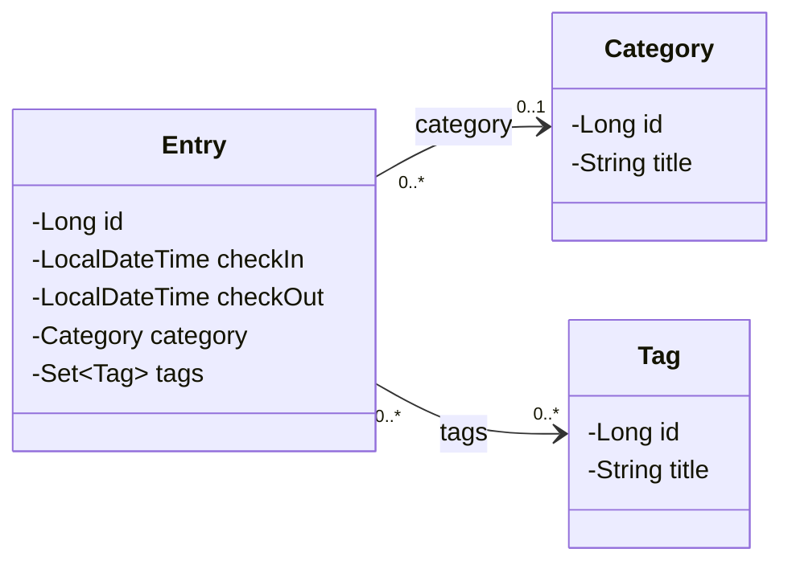

# Klassendiagramm

## Beziehungen

| Beziehung | Multiplizität | JPA | Bedeutung |
|---|---|---|---|
| Entry → Category | `0..*` zu `0..1` | `@ManyToOne` | Ein Entry hat höchstens eine Kategorie (oder keine). Eine Kategorie kann von beliebig vielen Entries verwendet werden. |
| Entry → Tag | `0..*` zu `0..*` | `@ManyToMany` (Zwischentabelle `entry_tag`) | Ein Entry kann beliebig viele Tags haben, ein Tag kann an beliebig vielen Entries hängen. |

Die Pfeile zeigen die Navigationsrichtung: Nur `Entry` kennt seine Kategorie und Tags. `Category` und `Tag` haben keine Liste ihrer Entries (unidirektionale Beziehungen).
